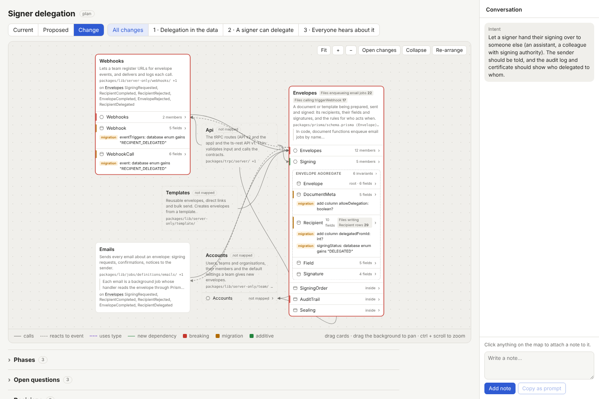

# seams

**Plan a code change at the level of boundaries before writing the code.**

You describe a change. Your coding agent maps the parts of the codebase it touches and writes one
HTML page: the modules, the data they own, the contracts between them, the storage and the
endpoints, plus what the change costs and what it needs you to decide.



- **One file per session.** The page opens in any browser, works offline and can be shared as is.
- **Made for reviewing fast.** A summary comes first, colour means one thing at a time, and
  everything starts collapsed.
- **Checked, not just drawn.** A checker catches cycles, modules reaching into each other's tables,
  lookups with no index, and endpoints calling things they shouldn't.
- **Readable by the agent too.** The page carries a text outline the agent validates its code against.

---

## Install

You need **Node 22.18 or newer** (`node -v` to check) and a coding agent that supports skills,
such as Claude Code.

```sh
curl -fsSL https://raw.githubusercontent.com/thehenrymcintosh/seams/main/install.sh | sh
```

This puts seams in `~/.seams`, adds a `seams` command to `~/.local/bin` and links the skill into
`~/.claude/skills/seams`. It needs no root and touches nothing else.

**Update** with `seams update`, or run the same line again.

Check it worked:

```sh
seams where      # prints ~/.seams
```

<details>
<summary>Install by hand instead</summary>

```sh
git clone https://github.com/thehenrymcintosh/seams.git
cd seams
npm link                                   # the seams command
ln -s "$(pwd)/skills/seams" ~/.claude/skills/seams   # the skill (Claude Code)
```

Or add just the skill with `npx skills add thehenrymcintosh/seams --skill seams` (`-g` for every project).

</details>

<details>
<summary>Change where it installs, or uninstall</summary>

Set `SEAMS_HOME`, `SEAMS_BIN` or `SEAMS_SKILLS` before `sh` to pick other folders.

To uninstall: `rm -rf ~/.seams ~/.local/bin/seams ~/.claude/skills/seams`

</details>

There's no build step and nothing else to install.

---

## Use it

In your project, ask the agent:

```
/seams we're letting signers delegate to someone else
```

Or just say "plan this change" or "help me understand how X works". The agent loads the skill on its own.

It writes two files in `plans/`:

| File | What it is |
| --- | --- |
| `<name>.plan.ts` | The plan's source. The agent edits this. |
| `<name>.plan.html` | The page you open and review. |

### Review loop

1. Open the `.html` file.
2. Click anything on the map and write a note about it in the sidebar.
3. Press **Copy as prompt** and paste the notes back to the agent.
4. The agent updates the plan and re-renders the same file.

### Keys on the page

| Key | Does |
| --- | --- |
| `/` | Jump to any module, endpoint, table or term |
| `Esc` | Clear the focus and filters |
| `f` | Fit the map to the screen |
| `1` `2` `3` | Show one phase of the change |

---

## What a plan contains

Only the decisions that matter at module level. Function bodies, frameworks and UI stay in code.

| Part | What it says | Example |
| --- | --- | --- |
| **Modules** | Who is responsible for what, and who depends on whom | `Envelopes` uses `Accounts` |
| **Data** | The tables each module owns, grouped into aggregates with their rules | `Envelope` + `Recipient`, "recipients only act while PENDING" |
| **Storage** | Where each table lives, and which index serves each lookup | Postgres `Recipient_token_idx` serves "find by token" |
| **Contracts** | What a module promises others: commands, queries, events, types | `Signing.Reject(token, reason) ! NotFound` |
| **Endpoints** | How the outside world gets in, with auth | `POST /api/v2/envelope/distribute` → `Envelopes.Send` |
| **Wiring** | What each module needs from outside (ports), what plugs in per environment, and whether it is injected | `Jobs`: Inngest in prod, local in dev, imported directly |
| **Signals** | The logs, metrics, traces and audit records, on the operation that emits them | audit `recipient delegated` on `Signing.Delegate` |
| **Tests** | The tests that exist and the ones the change needs, with level and fakes | unit: "the old token stops working", fakes `Jobs` |

On top of that, each plan has **phases** (slices that ship on their own), **questions** for you,
**decisions** with their reasons, and a **glossary** of the domain's own words.

### What the page shows

- **Summary at the top:** the request, change counts (red breaking, amber migration, green
  additive) that filter the map when clicked, your open questions, and the phases in order.
- **Colour by kind:** cyan endpoints, indigo contracts, pink events, violet types, slate data,
  blue storage, warm grey for wiring, signals and tests. Red, amber and green are kept for change
  costs only.
- **Cards read in request order:** endpoints, contracts, data, storage, then how it runs (wiring,
  signals, tests), then sub-modules.
- **Test coverage in place:** each operation lists the tests that prove it, or says "no test yet".
- **Focus:** click something and everything unrelated fades.
- **Quiet foundations:** a module nearly everything uses (like a shared model) gets a "used by N
  modules" badge instead of a wire from every card.
- **Domain words** are underlined in the text. Hover one to see what it means.

---

## Commands

| Command | Does |
| --- | --- |
| `seams new <name>` | Start `plans/<name>.plan.ts` from a template (`--learn` for a learning session) |
| `seams check <file>` | Run the checker |
| `seams render <file>` | Write the `.plan.html` page. Refuses if the plan has errors (`--force` to render anyway) |
| `seams read <file.html>` | Print the plan inside a page as JSON (`--outline` for the agent outline) |
| `seams verify <file>` | Check the plan against the code in this repo (`--tree proposed` after building, `--repo <dir>` for another folder) |
| `seams where` | Print where seams is installed |
| `seams update` | Pull the latest version |

`<file>` can be the `.plan.ts` source, a `.json` export, or a rendered `.html` page.

---

## What the checker catches

Errors stop `seams render`. Warnings are shown on the page.

- A dependency cycle between modules
- A module reading or writing another module's tables
- A contract that exposes a table instead of its own type
- Using another module's type without declaring the dependency
- Reaching into a sub-module from outside its parent
- A table in an aggregate with its own repository (only the root has one)
- A lookup with no index: a warning for SQL (full table scan), an error for DynamoDB (needs a scan)
- A store holding another module's table, or naming columns that don't exist
- An endpoint calling an operation the module can't reach
- A port the code imports directly, so tests can't swap it (and how many tests would need to)
- A signal or test pointing at something the module doesn't have
- A token or secret in a log field, or an id or email as a metric label
- A test faking something that isn't a port or a used contract

Example output from `examples/shop.tangled.ts`:

```
error   Orders / uses Gateway
        reaches inside Payments: Gateway is internal to it; use a contract Payments provides instead
error   Payments / OrderRepository
        reaches into storage owned by Orders; go through the Orders module's contract instead
error   Orders -> Payments -> Orders
        dependency cycle between modules
```

---

## Keeping plan and code in step

The checker asks whether a plan makes sense. `seams verify` asks whether the code agrees with it:

- every `src()` path exists and contains the symbol it names
- code in one module's folders imports another module only through a declared dependency, or a
  `gap()` the plan names on purpose ("calls triggerWebhook directly")
- every table, column and index in a store is in `schema.prisma` (Prisma only for now)
- every operation has code, and new operations and endpoints point at it with `src()`

The skill runs it twice. **After mapping**, on the current tree, so you never review a map that
doesn't match the code. **After building**, on the proposed tree, slice by slice; when the code has
to differ, the agent updates the plan instead. Before the Documenso change is built, verify lists
exactly what is left:

```
error   proposed: Api / endpoint recipient.delegateDocumentWithToken
        is new in this change; give it a src() pointing at the route that serves it
error   proposed: Envelopes / table Recipient
        column delegatedFromId is not in model Recipient
error   proposed: Envelopes / Signing.Delegate
        is new in this change; give it a src() pointing at the code that implements it
```

It checks structure, not behaviour: it knows `Signing.Delegate` exists, not that it keeps the
aggregate's rules. The planned tests cover that.

---

## Turning a plan into code

`run.ts` shows every view on the worked example (`node run.ts`, output in `out/`):

| View | File | What you get |
| --- | --- | --- |
| Code skeleton | `out/v2/skeleton/` | One folder per module: contract types, repositories, a `Deps` type with every port, `routes.ts`, `ports.ts`, `telemetry.ts` (a typed `emit`), planned tests as `node:test` todos, `.sql` DDL, DynamoDB key builders. It typechecks. |
| Change review | `out/change-v1-to-v2.md` | Every change tagged `breaking`, `migration`, `additive` or `internal` |
| Spec | `out/v2/spec.md` | A Markdown spec per module |
| Diagram | `out/v2/system.mmd` | A Mermaid diagram of the system |

---

<details>
<summary><b>Writing plans by hand</b></summary>

Plans are TypeScript using a small set of helpers (`src/dsl.ts`). They stay plain data.

```ts
const orders = module("Orders", {
  purpose: "Turns a basket into an order and tracks it.",
  entities: [entity("Order", { id: t.uuid, customerId: t.uuid, total: t.decimal })],
  repositories: [repo("Order", [get, findBy("customerId"), save])],
  stores: [store("orders db", "postgres", [table("Order", "orders", { indexes: [idx("customerId")] })])],
  provides: [contract("Orders", {
    operations: [command("PlaceOrder", { customerId: t.uuid }, t.uuid, ["EmptyOrder"])],
  })],
  endpoints: [http("POST", "/orders", "Orders.PlaceOrder", { auth: "session" })],
  uses: ["Catalog"],
});
```

- **Sub-modules** go in `modules: [...]`. Only the parent and its other sub-modules can use them.
- **Aggregates**: `aggregate("Order", ["OrderLine"], ["Total equals the sum of its lines."])`.
  Only the root gets a repository. A root can be found through a member: `findBy("Recipient.token")`.
- **DynamoDB**: `table("Payment", "payments", { pk: "PAY#{id}", gsis: [{ name: "byOrder", pk: "ORDER#{orderId}" }] })`.
- **Not mapped yet**: `stub("Billing", "What it does", ["Billing"])` names a module without detail.
- **Wiring**: `ports: [port("Clock", "The current time", ["now()"], { prod: "SystemClock", test: "FixedClock" })]`.
- **Signals**: `signals: [metric("orders_placed_total", "Orders.PlaceOrder", ["outcome"], { alert: "errors > 5% for 10m" })]`.
- **Tests**: `tests: [test("a paid order can't be cancelled", "unit", "Orders.CancelOrder", { fakes: ["Payments"] })]`.

</details>

<details>
<summary><b>Repo layout</b></summary>

| Path | What it is |
| --- | --- |
| `skills/seams/SKILL.md` | The skill: how the agent maps a repo into a plan |
| `src/ast.ts` | The plan's node types. Start here. |
| `src/dsl.ts` | Helpers for writing plans |
| `src/check.ts` | The checker |
| `src/storage.ts` | Which key or index serves each lookup |
| `src/views/` | Outline, diff, skeleton, spec and diagram views |
| `src/render/` | The HTML page (`client.js`, `client.css`, no dependencies) |
| `src/cli.ts` | The `seams` command |
| `examples/` | A small shop, before and after adding payments, plus a broken version |
| `plans/documenso-delegation.plan.ts` | A real run on [Documenso](https://github.com/documenso/documenso) |
| `plans/seams.plan.ts` | seams mapped with seams; `seams verify plans/seams.plan.ts` passes on this repo |
| `test/` | Tests for the checker, diff, verify and render |
| `docs/app-pitch.md` | Where this is heading |

</details>

<details>
<summary><b>Developing seams</b></summary>

```sh
npm install          # TypeScript, for typechecking only
node run.ts          # regenerate out/
npm run typecheck    # the code and the generated skeleton
npm test             # checker, diff, verify and render, with node:test
```

Node runs the `.ts` files directly, so the code avoids `enum`, `namespace` and parameter properties.

</details>

## Known limits

- Verify finds imports with a small scanner that skips comments and template strings, not the TypeScript
  compiler, so seams installs with no dependencies. It checks Prisma schemas only.
- The review loop is copy and paste. A command that sends notes straight back to the agent is next.
- Transactions, sync vs async calls and contract versions aren't modelled yet.
- The checker doesn't know which tests the change needs; the skill asks for one per new command and invariant.
