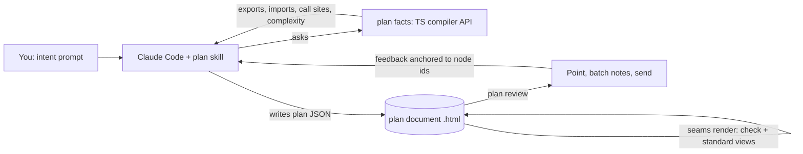

# Pitch: planning documents for code changes

Written in the format it is meant to produce, so it doubles as a sample of the output.
Revised after the first draft: this is a skill that writes standalone documents, not a server app.

## Problem

Planning a change happens either in prose, which drifts away from the code, or in the
code itself, where boundaries and responsibilities are hidden in detail. Agents can
already explain code in a rich HTML page (lavish-axi does this well), but every page is
drawn from scratch: a different diagram style, different sections, nothing a later
session or a reviewer can rely on. For planning, the shape of the document should be
standard, so the only thing that varies is the content.

## Appetite

One small batch, a couple of weeks: the format, the renderer, the skill and the code
facts working end to end on one real TypeScript repo. Polish waits until it has proven
useful on a real change.

## Solution

A skill you call when you want to plan a change or learn part of a codebase. Each call
produces one **plan document**: a single HTML file that holds the plan as data and draws
it in a fixed, standard way. The document is the record. It opens in any browser on its
own, and when opened with `seams review` every part of it can be pointed at and sent back
to the agent.

### The document

- **One file per session**, saved in the repo (for example `.plans/2026-10-18-payments.html`).
  The plan data is embedded as JSON inside it, so the file is both the readable page and
  the machine-readable source. Nothing else is needed to open it later.
- **Fixed sections**, always in this order, each hidden when empty:
  intent, map, contracts, proposed change, slices, open questions, decisions.
  A "learn" session is the same document with no proposed change.
- **Fixed visual grammar.** Modules are boxes, stored data is a cylinder, contracts are
  hexagons, calls are solid arrows, events are dashed arrows, and change tags are always
  breaking (red), migration (amber), additive (green). Layout is automatic. The agent
  writes data and never draws.
- **Interactive on its own:** click a node to open its inspector (contract signatures,
  who relies on it, where it lives in the code, code facts), collapse and expand stubs,
  and switch between the current tree, the proposed one and the diff.

### Feedback to the agent

Our own loop, modelled on lavish-axi's but built around plan nodes instead of HTML elements
(decided: build our own rather than depend on lavish).

- `seams review <doc.html>` serves the document locally and adds a review layer. You click
  any node, operation, change or slice and write a note; notes queue in a side panel and
  are sent as one batch.
- `seams poll <doc.html>` is what the agent runs: a long poll that returns the batch as
  structured notes, each anchored to a node id ("about `Orders/contract/Orders/CancelOrder`
  in the proposed tree"), not a CSS selector.
- The agent edits the plan, re-renders the same file, and the page reloads in place,
  keeping your unsent notes. `seams reply` posts a short answer into the panel.
- Notes can also carry intent: *ask about this*, *propose a change here*, *move to phase 2*,
  *map this stub*. Each becomes a typed request the skill knows how to handle.
- Without the server, the document is a complete read-only plan, and a *copy notes as
  prompt* button lets you paste feedback into any agent.

### Conceptual tree, deterministic facts

The tree is the agent's conceptual model, built lazily from the intent: deep where the
change is, collapsed stubs elsewhere, mapped further when needed. Links to code are best
effort, and a node can carry a note where the code doesn't fit the shape cleanly.

Deterministic analysis is a separate command the agent calls for evidence, never the
source of the tree:

- exported symbols and the import graph between folders,
- call sites of a symbol (who actually relies on a contract today),
- cyclomatic complexity per function, and fan-in and fan-out per folder.

Facts appear in the inspector as evidence on a node ("12 call sites in 4 folders",
"complexity hotspot: `placeOrder` 23"). They inform the boundaries but never become nodes.

### What stays from the prototype

The node types, the checker and the diff. `seams render` refuses to write a document whose
plan breaks a rule (a contract exposing a table, a dependency cycle, reaching into another
module's storage), and prints why, so the agent fixes the plan rather than the page.
The tree changes from the first draft stand: stable ids, `stub` / `mapped` depth, best
effort source references, notes and slices.

## Rabbit holes

- **Static analysis as the plan.** Facts are hints. Code rarely matches clean modules, and
  forcing it to is why deterministic tools have failed at this.
- **Review polish.** Lavish has layout checks, whiteboards and image attachments. We start
  with notes on nodes, batching and delivery, and add the rest only when it is missed.
- **Diagram layout.** Use ELK or dagre, inlined into the document; no hand-tuned canvas.
- **Keeping old documents current.** A document is a record of one session. A new session
  starts a new document and can read old ones for context.

## No-gos

- No server or app of our own. Skill, CLI and a document.
- No editing code from a planning session. Output is a plan, a spec and skeletons.
- No node types below module and contract level (functions, classes, files).
- Nothing leaves the machine. Rendered documents make no network requests.

## Slices

1. **Format and renderer.** The embedded JSON format and `seams render`, producing the
   standard document with map, inspector, diff and slices. Proven on the shop example.
2. **Skill.** The SKILL.md that takes an intent, maps lazily, renders, and iterates.
   Run on a real open-source TypeScript repo.
3. **Facts.** `seams facts` over the TypeScript compiler API: imports, exports, call sites,
   complexity, surfaced in the inspector.
4. **Review loop.** `seams review`, `seams poll` and `seams reply`: notes on nodes, batching,
   delivery to the agent, live reload, and a marker for what changed in each round.
5. **Slicing and export.** Group the diff into phases and export the pitch and per-slice
   code skeletons.

Each slice ends with something you can use: after 1 you can read a plan, after 2 you
can ask for one, after 4 you can plan in conversation.
