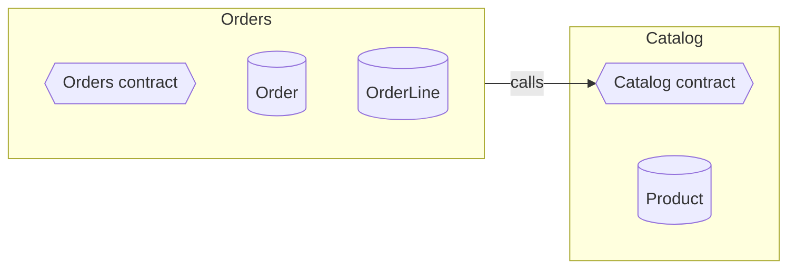
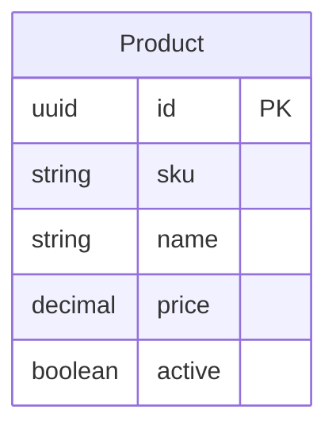
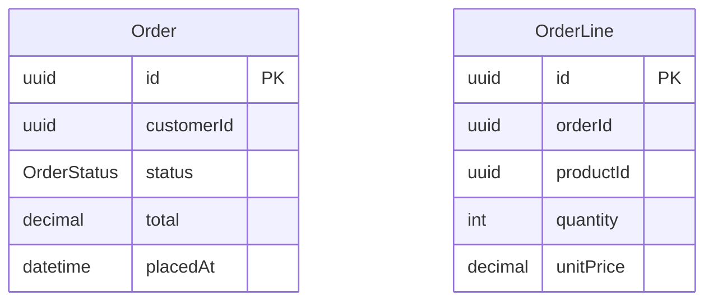

# shop v1

## Catalog

Owns what can be sold and at what price.

**Depends on:** nothing

### Data

- `ProductRepository`: get by key, find by sku, find by active, save

### Contract `Catalog`

- type **ProductSummary** { id: uuid, name: string, price: decimal }
- query `GetProduct(id: uuid) → ProductSummary` · fails with NotFound
- query `ListActive() → ProductSummary[]`
- event **ProductPriceChanged** { productId: uuid, price: decimal }

## Orders

Turns a customer's basket into an order and tracks it to completion.

**Depends on:** Catalog

### Data

- `OrderRepository`: get by key, find by customerId, save

### Contract `Orders`

- type **OrderStatus** = `Placed` \| `Cancelled`
- type **LineInput** { productId: uuid, quantity: int }
- type **OrderLineView** { product: Catalog.ProductSummary, quantity: int, unitPrice: decimal }
- type **OrderView** { id: uuid, status: OrderStatus, total: decimal, lines: OrderLineView[] }
- command `PlaceOrder(customerId: uuid, lines: LineInput[]) → OrderView` · fails with EmptyOrder, UnknownProduct
- command `CancelOrder(id: uuid) → void` · fails with NotFound, AlreadyCancelled
- query `GetOrder(id: uuid) → OrderView` · fails with NotFound
- query `ListForCustomer(customerId: uuid) → OrderView[]`
- event **OrderPlaced** { orderId: uuid, total: decimal }

### Uses

- `Catalog`
