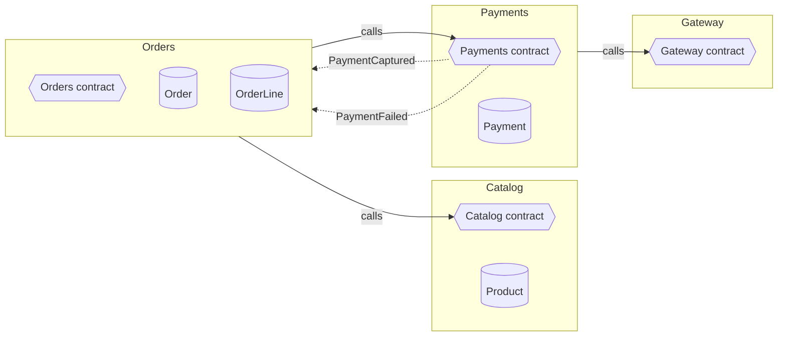
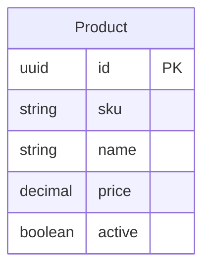
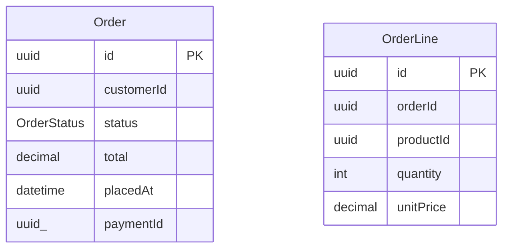
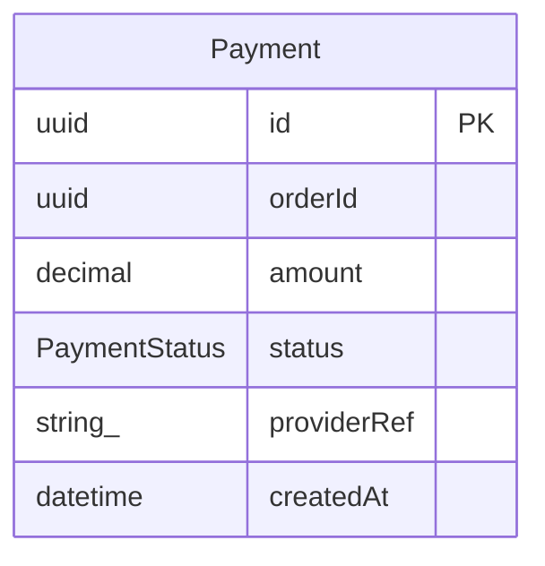

# shop v2

## Catalog

Owns what can be sold and at what price.

**Depends on:** nothing

### Data

- `ProductRepository`: get by key, find by sku, find by active, save

### Contract `Catalog`

- type **ProductSummary** { id: uuid, name: string, price: decimal }
- query `GetProduct(id: uuid) → ProductSummary` · fails with NotFound
- query `ListActive() → ProductSummary[]`
- event **ProductPriceChanged** { productId: uuid, price: decimal }

## Orders

Turns a customer's basket into an order and tracks it to completion.

**Depends on:** Catalog, Payments

### Data

- `OrderRepository`: get by key, find by customerId, save

### Contract `Orders`

- type **OrderStatus** = `AwaitingPayment` \| `Paid` \| `PaymentFailed` \| `Cancelled`
- type **LineInput** { productId: uuid, quantity: int }
- type **OrderLineView** { product: Catalog.ProductSummary, quantity: int, unitPrice: decimal }
- type **OrderView** { id: uuid, status: OrderStatus, total: decimal, lines: OrderLineView[] }
- command `PlaceOrder(customerId: uuid, lines: LineInput[]) → OrderView` · fails with EmptyOrder, UnknownProduct
- command `CancelOrder(id: uuid) → void` · fails with NotFound, AlreadyCancelled, AlreadyPaid
- query `GetOrder(id: uuid) → OrderView` · fails with NotFound
- query `ListForCustomer(customerId: uuid) → OrderView[]`
- event **OrderPlaced** { orderId: uuid, total: decimal }
- event **OrderPaid** { orderId: uuid }

### Uses

- `Catalog`
- `Payments`, reacts to PaymentCaptured, PaymentFailed

## Payments

Collects money for an order and reports the outcome. Knows nothing about what was bought.

**Depends on:** Gateway

### Data

- `PaymentRepository`: get by key, find by orderId, save

### Contract `Payments`

- type **PaymentStatus** = `Pending` \| `Captured` \| `Failed`
- command `StartPayment(orderId: uuid, amount: decimal) → uuid` · fails with AlreadyPaid
- query `GetStatus(orderId: uuid) → PaymentStatus` · fails with NotFound
- event **PaymentCaptured** { paymentId: uuid, orderId: uuid }
- event **PaymentFailed** { orderId: uuid, reason: string }

### Uses

- `Gateway`

## Gateway

Talks to the card provider. One implementation per provider; nothing outside Payments sees it.

**Depends on:** nothing

### Contract `Gateway`

- command `Charge(amount: decimal, reference: string) → string` · fails with Declined, ProviderDown
